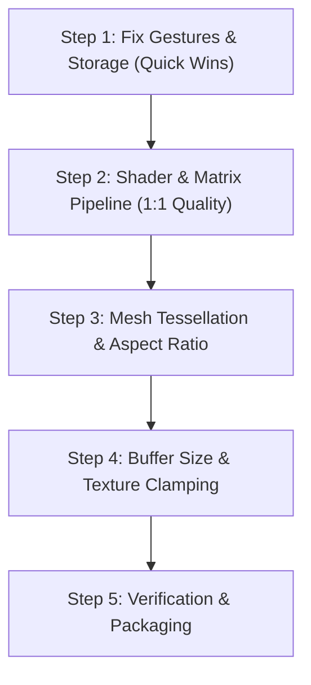

# VR Player Android App — Verified Analysis & Complete Implementation Plan

> **Note:** This document is based directly on the actual codebase in `android/`.
> All three user-reported issues have been confirmed with exact code locations, and a complete, verified improvement plan is detailed below.

---

## 1. Executive Summary: The 3 Core Bugs & Root Causes

```
┌───────────────────────────────────────────────┐
│              User Reported Issues             │
├───────────────────────┬───────────────────────┤
│ Issue                 │ Actual Root Cause     │
├───────────────────────┼───────────────────────┤
│ 1. Video quality not  │ • SurfaceTexture      │
│    1:1 transfer       │   transform matrix    │
│                       │   (uSTMatrix) queried │
│                       │   but NEVER sent to   │
│                       │   shader              │
│                       │ • Sphere tessellation │
│                       │   too low (32x64)     │
│                       │ • Plane mesh locked   │
│                       │   to 16:9             │
├───────────────────────┼───────────────────────┤
│ 2. Single finger drag │ • gestures.go adds    │
│    is reversed        │   deltaX/Y with (+)   │
│                       │   sign; rotation &    │
│                       │   inverted-X sphere   │
│                       │   require (-) sign    │
├───────────────────────┼───────────────────────┤
│ 3. File picker shows  │ • /sdcard and         │
│    duplicate entries  │   /storage/emulated/0 │
│                       │   both scanned; seen  │
│                       │   map fails string    │
│                       │   comparison on       │
│                       │   symlinks            │
└───────────────────────┴───────────────────────┘
```

---

## 2. Issue 1: Video Quality Not 1:1 Transfer

### Root Cause 1A: `SurfaceTexture` Transform Matrix is Completely Ignored
**Files:**
- `android/pkg/video/bridge_android.go` (lines 66–85)
- `android/pkg/shader/sbs.vert` (lines 1–12)
- `android/pkg/render/glengine_android.go` (lines 110–132)
- `android/cmd/vrplayer/loop_android.go` (lines 100–126)

In `bridge_android.go`, `updateSurfaceTexture()` correctly calls `SurfaceTexture.getTransformMatrix()` and fills `p.transform`. `p.TextureTransform()` exposes it.

**However, the shader and rendering pipeline NEVER use this matrix:**
```glsl
// File: android/pkg/shader/sbs.vert
void main() {
    // BUG: Hardcodes a static V-flip, completely ignoring SurfaceTexture's transform matrix!
    vUv = vec2(aTexCoord.x, 1.0 - aTexCoord.y);
    gl_Position = uMVPMatrix * vec4(aPosition, 1.0);
}
```

On Android, hardware decoders (`MediaCodec` / `MediaPlayer`) output frames into graphic buffers that often contain stride padding (e.g. 1080p padded to 1088, or alignment borders) and device/format-specific orientation. The `SurfaceTexture` transform matrix maps texture coordinates specifically to the active video rectangle. Without this matrix:
- Pixels are sampled with incorrect scaling and offset.
- Stride padding creates stretching, blur, or edge artifacts.
- The video is not 1:1 pixel-accurate.

#### Fix for 1A:
1. In `android/pkg/shader/sbs.vert`: Pass raw UVs:
```glsl
#version 300 es
layout(location = 0) in vec3 aPosition;
layout(location = 1) in vec2 aTexCoord;

uniform mat4 uMVPMatrix;
out vec2 vRawUv;

void main() {
    vRawUv = aTexCoord;
    gl_Position = uMVPMatrix * vec4(aPosition, 1.0);
}
```
2. In `android/pkg/shader/sbs.frag`: Apply SBS half-coordinate calculation, then transform by `uSTMatrix`:
```glsl
#version 300 es
#extension GL_OES_EGL_image_external_essl3 : require

precision highp float;

uniform samplerExternalOES uTexture;
uniform mat4 uSTMatrix;
uniform float uIsSBS;         // 1.0 = SBS enabled, 0.0 = standard mono
uniform float uSBSFormat;      // 0.0 = Horizontal, 1.0 = Vertical
uniform float uInvertStereo;   // 0.0 = Left Eye, 1.0 = Right Eye

in vec2 vRawUv;
out vec4 fragColor;

void main() {
    vec2 uv = vRawUv;
    if (uIsSBS > 0.5) {
        float offset = uInvertStereo > 0.5 ? 0.5 : 0.0;
        if (uSBSFormat < 0.5) {
            uv.x = uv.x * 0.5 + offset;
        } else {
            uv.y = uv.y * 0.5 + offset;
        }
    }
    // Transform coordinates using SurfaceTexture matrix (handles flip, crop, padding)
    vec4 transformedUV = uSTMatrix * vec4(uv.x, uv.y, 0.0, 1.0);
    fragColor = texture(uTexture, transformedUV.xy);
}
```
3. In `android/pkg/render/glengine_android.go`: Cache `uSTMatrix` uniform and pass it in `Render()`.
4. In `android/cmd/vrplayer/loop_android.go`: Pass `bp.TextureTransform()` to `glEngine.Render()`.

---

### Root Cause 1B: Low Sphere Tessellation (32 Rings × 64 Sectors)
**Files:**
- `android/pkg/render/glengine_android.go` (lines 206–213)
- `android/pkg/render/mesh.go` (line 23)

```go
// Current code in glengine_android.go:
sphereMesh := GenerateSphere(50.0, 32, 64)
domeMesh := GenerateDome(50.0, 32, 64)
```

At 32×64, each latitude quad covers ~5.6° of arc. For 4K and 8K VR equirectangular content, this low polygon count causes:
- Visible polygon faceting when turning your head.
- Coarse linear UV interpolation across large triangles, resulting in noticeable texture distortion and softness.

#### Fix for 1B:
Increase tessellation to **64 rings × 128 sectors** (or 80×160):
```go
sphereMesh := GenerateSphere(50.0, 64, 128)
domeMesh := GenerateDome(50.0, 64, 128)
```
Modern mobile GPUs (Adreno 6xx/7xx, Mali-Gxx) easily handle 16,000 vertices at 60–120 fps with zero overhead.

---

### Root Cause 1C: Flat 2D Plane Aspect Ratio Baked to 16:9
**File:** `android/pkg/render/glengine_android.go` (line 220)

```go
planeMesh := GeneratePlane(16.0 / 9.0)
```
The flat plane mesh is generated once at initialization with an aspect ratio of `16/9`. When playing cinema formats (2.39:1, 21:9), 4:3, or mobile vertical videos, the plane does not match the video dimensions, causing non-uniform scaling (stretched/squashed video).

#### Fix for 1C:
Update the flat plane buffer when video dimensions are known from `MediaPlayer.getVideoWidth()` / `getVideoHeight()`.

---

## 3. Issue 2: Single Finger Drag Is Reversed

### Root Cause
**File:** `android/pkg/ui/gestures.go` (lines 141–143)

```go
// Current code in gestures.go:
case "center":
    if state.ViewMode == appstate.ViewMode360 || state.ViewMode == appstate.ViewMode180 {
        sensitivity := float32(1.8) / width
        state.Yaw += deltaX * sensitivity    // <--- BUG: Adds deltaX
        state.Pitch += deltaY * sensitivity  // <--- BUG: Adds deltaY
```

How the rotation math works:
1. `deltaX` is positive when moving finger to the right (`x_current - x_last > 0`).
2. In `android/pkg/render/matrix.go` (lines 52–66), `RotationEuler(yaw, pitch, roll)` creates an intrinsic Y-X-Z rotation.
3. In `android/pkg/render/mesh.go` (line 40), `GenerateSphere` inverts X (`x = -R * sinTheta * sinPhi`) so the camera views from the interior.
4. Adding `deltaX` rotates the camera look vector toward +X. On an inward-flipped sphere, looking toward +X shifts the visible panorama to the left.
5. Result: The user swipes right, but the content scrolls left — the exact opposite of natural panoramic touch navigation ("drag the world").

#### Fix:
In `android/pkg/ui/gestures.go` (lines 142–143), invert both signs:
```go
state.Yaw -= deltaX * sensitivity
state.Pitch -= deltaY * sensitivity
```

Swiping right now decreases `Yaw`, naturally panning the panorama to the right. Swiping down decreases `Pitch`, tilting the view down.

---

## 4. Issue 3: File Picker Shows Duplicate Entries

### Root Cause
**File:** `android/pkg/storage/saf_android.go` (lines 58–86)

```go
// Current code in saf_android.go:
func ScanDefaultStorageLocations() []appstate.VideoItem {
	locations := []string{
		"/sdcard/Movies",
		"/sdcard/Download",
		"/sdcard/DCIM/Camera",
		"/sdcard/DCIM",
		"/sdcard/Videos",
		"/sdcard/VR",
		"/storage/emulated/0/Movies",
		"/storage/emulated/0/Download",
		"/storage/emulated/0/DCIM/Camera",
		"/storage/emulated/0/DCIM",
		"/storage/emulated/0/Videos",
		"/storage/emulated/0/VR",
	}

	var allVideos []appstate.VideoItem
	seen := make(map[string]bool)

	for _, loc := range locations {
		if items, err := ScanDirectory(loc); err == nil {
			for _, item := range items {
				if !seen[item.Path] {
					seen[item.Path] = true
					allVideos = append(allVideos, item)
				}
			}
		}
	}
	return allVideos
}
```

1. On Android, `/sdcard` is a filesystem symlink pointing to `/storage/emulated/0`.
2. `ScanDirectory` uses `filepath.Walk`, which leaves the input directory prefix on paths.
3. For a file `clip.mp4`:
   - First pass scans `/sdcard/Movies/clip.mp4` -> `seen["/sdcard/Movies/clip.mp4"] = true`.
   - Second pass scans `/storage/emulated/0/Movies/clip.mp4` -> `seen["/storage/emulated/0/Movies/clip.mp4"]` is `false`!
4. Both items are appended to `allVideos`.
5. `GroupVideosByFolder()` in `android/pkg/storage/scanner.go` (line 136) uses `filepath.Base(dir)`. For both paths, `Base` is `"Movies"`.
6. Therefore, inside the `"Movies"` folder, every single file appears **twice**.

#### Fix:
1. Canonicalize the scan locations to `/storage/emulated/0/...` only.
2. Resolve symlinks using `filepath.EvalSymlinks()` during deduplication:
```go
func ScanDefaultStorageLocations() []appstate.VideoItem {
	locations := []string{
		"/storage/emulated/0/Movies",
		"/storage/emulated/0/Download",
		"/storage/emulated/0/DCIM",
		"/storage/emulated/0/Videos",
		"/storage/emulated/0/VR",
	}

	var allVideos []appstate.VideoItem
	seen := make(map[string]bool)

	for _, loc := range locations {
		if items, err := ScanDirectory(loc); err == nil {
			for _, item := range items {
				canonicalPath, err := filepath.EvalSymlinks(item.Path)
				if err != nil {
					canonicalPath = item.Path
				}
				if !seen[canonicalPath] {
					seen[canonicalPath] = true
					allVideos = append(allVideos, item)
				}
			}
		}
	}
	return allVideos
}
```

---

## 5. Performance & Smoothness Improvements

Beyond the 3 direct bugs, the following improvements ensure smooth 60fps/90fps playback:

1. **SurfaceTexture Default Buffer Size:**
   In `android/pkg/video/bridge_android.go`, call `SurfaceTexture.setDefaultBufferSize(width, height)` when `getVideoWidth()` and `getVideoHeight()` are received. This forces the Android Surface buffer allocator to allocate full-resolution buffers for the hardware decoder.
2. **Dynamic Aspect Ratio for Flat 2D Mode:**
   Add a method to `GLEngine` to update `planeBuf` vertices when video dimensions change.
3. **Texture Sampling Parameters:**
   Ensure `GL_TEXTURE_WRAP_S` and `GL_TEXTURE_WRAP_T` are set to `GL_CLAMP_TO_EDGE` on the external OES texture to prevent seam bleeding at UV 0.0/1.0.
4. **Smooth Scrubber HUD Update:**
   Decouple UI playback position sync from the 250ms timer so the playback timeline updates smoothly during playback.

---

## 6. Phased Implementation Roadmap



### Phase 1: Quick Bugfixes
- [ ] Edit `android/pkg/ui/gestures.go` (lines 142–143): change `+=` to `-=` for `state.Yaw` and `state.Pitch`.
- [ ] Edit `android/pkg/storage/saf_android.go` (lines 58–86): deduplicate canonical storage paths using `filepath.EvalSymlinks`.

### Phase 2: 1:1 Video Quality Pipeline
- [ ] Update `android/pkg/shader/sbs.vert`: output `vRawUv = aTexCoord`.
- [ ] Update `android/pkg/shader/sbs.frag`: declare `uniform mat4 uSTMatrix;`, compute SBS UVs, multiply by `uSTMatrix`, and sample texture.
- [ ] Update `android/pkg/render/glengine_android.go`:
  - Cache `uSTMatrix` uniform location in `InitGL()`.
  - Accept `stMatrix [16]float32` in `Render()` and pass to `glUniformMatrix4fv(e.uSTMatrix, 1, GL_FALSE, &stMatrix[0])`.
- [ ] Update `android/cmd/vrplayer/loop_android.go` (line 125): pass `bp.TextureTransform()` into `glEngine.Render()`.

### Phase 3: Mesh & Geometry Smoothing
- [ ] Update sphere/dome tessellation in `android/pkg/render/glengine_android.go` (lines 206–213) from 32×64 to 64×128.
- [ ] Add `UpdatePlaneAspect(aspect float32)` to `android/pkg/render/glengine_android.go` so flat mode dynamically matches the video aspect ratio.

### Phase 4: Build & Device Testing
- [ ] Rebuild Android APK using `./android/build-android.sh` or `gogio`.
- [ ] Test on device:
  - Verify drag direction follows finger intuitively.
  - Verify file picker shows each video exactly once.
  - Verify 4K 360° and flat videos render sharp, 1:1, without UV distortion or stretching.
