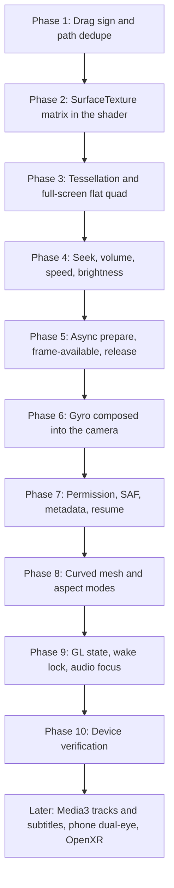

# VR Player Android App — Verified Analysis & Complete Implementation Plan

> **Note:** This document is based directly on the actual codebase in `android/`.
> The three user-reported issues are confirmed with exact code locations. A second pass of the same tree added the control, gyro, decoder, library, projection, and session gaps below. Those features exist as types or buttons and do not reach playback or the camera.

---

## 1. Executive Summary: The 3 Core Bugs & Root Causes

```
┌───────────────────────────────────────────────┐
│              User Reported Issues             │
├───────────────────────┬───────────────────────┤
│ Issue                 │ Actual Root Cause     │
├───────────────────────┼───────────────────────┤
│ 1. Video quality not  │ • SurfaceTexture      │
│    1:1 transfer       │   transform matrix    │
│                       │   (uSTMatrix) queried │
│                       │   but NEVER sent to   │
│                       │   shader              │
│                       │ • Sphere tessellation │
│                       │   too low (32x64)     │
│                       │ • Plane mesh locked   │
│                       │   to 16:9             │
├───────────────────────┼───────────────────────┤
│ 2. Single finger drag │ • gestures.go adds    │
│    is reversed        │   deltaX/Y with (+)   │
│                       │   sign; rotation &    │
│                       │   inverted-X sphere   │
│                       │   require (-) sign    │
├───────────────────────┼───────────────────────┤
│ 3. File picker shows  │ • /sdcard and         │
│    duplicate entries  │   /storage/emulated/0 │
│                       │   both scanned; seen  │
│                       │   map fails string    │
│                       │   comparison on       │
│                       │   symlinks            │
└───────────────────────┴───────────────────────┘
```

---

## 2. Issue 1: Video Quality Not 1:1 Transfer

### Root Cause 1A: `SurfaceTexture` Transform Matrix is Completely Ignored
**Files:**
- `android/pkg/video/bridge_android.go` (lines 66–85)
- `android/pkg/shader/sbs.vert` (lines 1–12)
- `android/pkg/render/glengine_android.go` (lines 110–132)
- `android/cmd/vrplayer/loop_android.go` (lines 100–126)

In `bridge_android.go`, `updateSurfaceTexture()` correctly calls `SurfaceTexture.getTransformMatrix()` and fills `p.transform`. `p.TextureTransform()` exposes it.

**However, the shader and rendering pipeline NEVER use this matrix:**
```glsl
// File: android/pkg/shader/sbs.vert
void main() {
    // BUG: Hardcodes a static V-flip, completely ignoring SurfaceTexture's transform matrix!
    vUv = vec2(aTexCoord.x, 1.0 - aTexCoord.y);
    gl_Position = uMVPMatrix * vec4(aPosition, 1.0);
}
```

On Android, hardware decoders (`MediaCodec` / `MediaPlayer`) output frames into graphic buffers that often contain stride padding (e.g. 1080p padded to 1088, or alignment borders) and device/format-specific orientation. The `SurfaceTexture` transform matrix maps texture coordinates specifically to the active video rectangle. Without this matrix:
- Pixels are sampled with incorrect scaling and offset.
- Stride padding creates stretching, blur, or edge artifacts.
- The video is not 1:1 pixel-accurate.

#### Fix for 1A:
1. In `android/pkg/shader/sbs.vert`: Pass raw UVs:
```glsl
#version 300 es
layout(location = 0) in vec3 aPosition;
layout(location = 1) in vec2 aTexCoord;

uniform mat4 uMVPMatrix;
out vec2 vRawUv;

void main() {
    vRawUv = aTexCoord;
    gl_Position = uMVPMatrix * vec4(aPosition, 1.0);
}
```
2. In `android/pkg/shader/sbs.frag`: Apply SBS half-coordinate calculation, then transform by `uSTMatrix`:
```glsl
#version 300 es
#extension GL_OES_EGL_image_external_essl3 : require

precision highp float;

uniform samplerExternalOES uTexture;
uniform mat4 uSTMatrix;
uniform float uIsSBS;         // 1.0 = SBS enabled, 0.0 = standard mono
uniform float uSBSFormat;      // 0.0 = Horizontal, 1.0 = Vertical
uniform float uInvertStereo;   // 0.0 = Left Eye, 1.0 = Right Eye

in vec2 vRawUv;
out vec4 fragColor;

void main() {
    vec2 uv = vRawUv;
    if (uIsSBS > 0.5) {
        float offset = uInvertStereo > 0.5 ? 0.5 : 0.0;
        if (uSBSFormat < 0.5) {
            uv.x = uv.x * 0.5 + offset;
        } else {
            uv.y = uv.y * 0.5 + offset;
        }
    }
    // Transform coordinates using SurfaceTexture matrix (handles flip, crop, padding)
    vec4 transformedUV = uSTMatrix * vec4(uv.x, uv.y, 0.0, 1.0);
    fragColor = texture(uTexture, transformedUV.xy);
}
```
3. In `android/pkg/render/glengine_android.go`: Cache `uSTMatrix` uniform and pass it in `Render()`.
4. In `android/cmd/vrplayer/loop_android.go`: Pass `bp.TextureTransform()` to `glEngine.Render()`.

---

### Root Cause 1B: Low Sphere Tessellation (32 Rings × 64 Sectors)
**Files:**
- `android/pkg/render/glengine_android.go` (lines 206–213)
- `android/pkg/render/mesh.go` (line 23)

```go
// Current code in glengine_android.go:
sphereMesh := GenerateSphere(50.0, 32, 64)
domeMesh := GenerateDome(50.0, 32, 64)
```

At 32×64, each latitude quad covers ~5.6° of arc. For 4K and 8K VR equirectangular content, this low polygon count causes:
- Visible polygon faceting when turning your head.
- Coarse linear UV interpolation across large triangles, resulting in noticeable texture distortion and softness.

#### Fix for 1B:
Increase tessellation to **64 rings × 128 sectors** (or 80×160):
```go
sphereMesh := GenerateSphere(50.0, 64, 128)
domeMesh := GenerateDome(50.0, 64, 128)
```
Modern mobile GPUs (Adreno 6xx/7xx, Mali-Gxx) easily handle 16,000 vertices at 60–120 fps with zero overhead.

---

### Root Cause 1C: Flat 2D Plane Aspect Ratio Baked to 16:9
**File:** `android/pkg/render/glengine_android.go` (line 220)

```go
planeMesh := GeneratePlane(16.0 / 9.0)
```
The flat plane mesh is generated once at initialization with an aspect ratio of `16/9`. When playing cinema formats (2.39:1, 21:9), 4:3, or mobile vertical videos, the plane does not match the video dimensions, causing non-uniform scaling (stretched/squashed video).

#### Fix for 1C:
Update the flat plane buffer when video dimensions are known from `MediaPlayer.getVideoWidth()` / `getVideoHeight()`.

---

## 3. Issue 2: Single Finger Drag Is Reversed

### Root Cause
**File:** `android/pkg/ui/gestures.go` (lines 141–143)

```go
// Current code in gestures.go:
case "center":
    if state.ViewMode == appstate.ViewMode360 || state.ViewMode == appstate.ViewMode180 {
        sensitivity := float32(1.8) / width
        state.Yaw += deltaX * sensitivity    // <--- BUG: Adds deltaX
        state.Pitch += deltaY * sensitivity  // <--- BUG: Adds deltaY
```

How the rotation math works:
1. `deltaX` is positive when moving finger to the right (`x_current - x_last > 0`).
2. In `android/pkg/render/matrix.go` (lines 52–66), `RotationEuler(yaw, pitch, roll)` creates an intrinsic Y-X-Z rotation.
3. In `android/pkg/render/mesh.go` (line 40), `GenerateSphere` inverts X (`x = -R * sinTheta * sinPhi`) so the camera views from the interior.
4. Adding `deltaX` rotates the camera look vector toward +X. On an inward-flipped sphere, looking toward +X shifts the visible panorama to the left.
5. Result: The user swipes right, but the content scrolls left — the exact opposite of natural panoramic touch navigation ("drag the world").

#### Fix:
In `android/pkg/ui/gestures.go` (lines 142–143), invert both signs:
```go
state.Yaw -= deltaX * sensitivity
state.Pitch -= deltaY * sensitivity
```

Swiping right now decreases `Yaw`, naturally panning the panorama to the right. Swiping down decreases `Pitch`, tilting the view down.

---

## 4. Issue 3: File Picker Shows Duplicate Entries

### Root Cause
**File:** `android/pkg/storage/saf_android.go` (lines 58–86)

```go
// Current code in saf_android.go:
func ScanDefaultStorageLocations() []appstate.VideoItem {
	locations := []string{
		"/sdcard/Movies",
		"/sdcard/Download",
		"/sdcard/DCIM/Camera",
		"/sdcard/DCIM",
		"/sdcard/Videos",
		"/sdcard/VR",
		"/storage/emulated/0/Movies",
		"/storage/emulated/0/Download",
		"/storage/emulated/0/DCIM/Camera",
		"/storage/emulated/0/DCIM",
		"/storage/emulated/0/Videos",
		"/storage/emulated/0/VR",
	}

	var allVideos []appstate.VideoItem
	seen := make(map[string]bool)

	for _, loc := range locations {
		if items, err := ScanDirectory(loc); err == nil {
			for _, item := range items {
				if !seen[item.Path] {
					seen[item.Path] = true
					allVideos = append(allVideos, item)
				}
			}
		}
	}
	return allVideos
}
```

1. On Android, `/sdcard` is a filesystem symlink pointing to `/storage/emulated/0`.
2. `ScanDirectory` uses `filepath.Walk`, which leaves the input directory prefix on paths.
3. For a file `clip.mp4`:
   - First pass scans `/sdcard/Movies/clip.mp4` -> `seen["/sdcard/Movies/clip.mp4"] = true`.
   - Second pass scans `/storage/emulated/0/Movies/clip.mp4` -> `seen["/storage/emulated/0/Movies/clip.mp4"]` is `false`!
4. Both items are appended to `allVideos`.
5. `GroupVideosByFolder()` in `android/pkg/storage/scanner.go` (line 136) uses `filepath.Base(dir)`. For both paths, `Base` is `"Movies"`.
6. Therefore, inside the `"Movies"` folder, every single file appears **twice**.

#### Fix:
1. Canonicalize the scan locations to `/storage/emulated/0/...` only.
2. Resolve symlinks using `filepath.EvalSymlinks()` during deduplication:
```go
func ScanDefaultStorageLocations() []appstate.VideoItem {
	locations := []string{
		"/storage/emulated/0/Movies",
		"/storage/emulated/0/Download",
		"/storage/emulated/0/DCIM",
		"/storage/emulated/0/Videos",
		"/storage/emulated/0/VR",
	}

	var allVideos []appstate.VideoItem
	seen := make(map[string]bool)

	for _, loc := range locations {
		if items, err := ScanDirectory(loc); err == nil {
			for _, item := range items {
				canonicalPath, err := filepath.EvalSymlinks(item.Path)
				if err != nil {
					canonicalPath = item.Path
				}
				if !seen[canonicalPath] {
					seen[canonicalPath] = true
					allVideos = append(allVideos, item)
				}
			}
		}
	}
	return allVideos
}
```

---

## 5. Limits on the Three Fixes Above

Apply these constraints while doing Phases 1–3. They change how those fixes should land.

1. **One rotation convention for touch and gyro.** Inverting `Yaw` / `Pitch` in `gestures.go` matches the inward sphere (`mesh.go` negates X) and `RotationEuler`. `loop_android.go` does not read the sensor yet. When Phase 7 multiplies in `Tracker.GetOrientationMatrix()`, both inputs must use that same sign. Recenter in `overlay.go` and `vrbar.go` already zeros `Yaw` and `Pitch` and calls `Tracker.Recenter()`. Those two resets have to stay paired.
2. **`uint16` index ceiling.** A 64×128 sphere is `(64+1)×(128+1) = 8385` vertices and fits in `GL_UNSIGNED_SHORT`. Past roughly 250×250 rings and sectors, `uploadMesh` must switch to `uint32` indices. Do not raise tessellation past that without the index change.
3. **Flat plane does not fill the view.** `GeneratePlane` builds a quad of height 1 at `z = -2`. At the default 75° FOV the visible half-height at that distance is about 1.53, so the video covers about a third of the screen height. `UpdatePlaneAspect` has to resize the quad into the projection (fit / stretch / crop / 100%), using `state.AspectRatio`. Changing the aspect alone still leaves a small card.
4. **SBS crop happens before the `SurfaceTexture` matrix, and only that matrix flips V.** The current vertex shader also flips V. After Phase 2, drop the hardcoded flip. Applying both inverts the picture. Check the first decoded frame upright on device before calling the shader done.
5. **External-texture wrap is already correct.** `createExternalTexture()` in `glengine_android.go` sets `GL_CLAMP_TO_EDGE` on S and T. No further wrap change.

---

## 6. Controls Write `AppState` and Never Call the Player

`main.go` connects overlay play/pause, scrubber seek, and open-file to `video.Player`. The gesture path and several chips do not.

| Control | Where | What it does today | Missing call |
|---|---|---|---|
| Double-tap ±10s | `gestures.go` `handleTap` | Writes `state.Position` | `Player.Seek`. The 250 ms ticker in `main.go` then overwrites `Position` from `getCurrentPosition()`. |
| Flat horizontal drag | `gestures.go` center zone, flat mode | Adds into `SeekDeltaSeconds` | On release, seek to `Position + delta` and zero the delta. Release only clears `ShowSeekHUD`. |
| Volume swipe | `gestures.go` right 15% | Writes `state.Volume` (0–2) | `Player.SetVolume` |
| Mute chip | `overlay.go` `btnVolume` | Toggles `state.IsMuted` | `SetVolume(0)` and restore |
| Speed chip | `overlay.go` `btnSpeed` | Cycles `PlaybackSpeed` | `Player.SetPlaybackSpeed` |
| Brightness swipe | `gestures.go` left 15% | Writes `state.Brightness` | Android window `screenBrightness` |
| Long-press 2× | Not present | — | Hold sets speed 2×, release restores the previous speed |
| Drag inertia | Not present | Yaw/pitch stop on release | Damped continuation after the finger lifts, in VR modes only |

`Player.SetVolume` and `SetPlaybackSpeed` already exist on `AndroidPlayer` and are unused from the UI.

The 250 ms ticker is also why the scrubber cannot move smoothly. While `IsPlaying` it assigns `state.Position` from the decoder. While the user is dragging the scrubber, skip that assign. Drive a UI invalidate from the frame loop during playback so the thumb is not stuck on a 4 Hz clock.

---

## 7. Head Tracking Is Sampled and Never Applied

`main.go` starts `SensorListener` at 100 Hz. `OnRecenter` calls `sensorTracker.Recenter()`. `GetOrientationMatrix()` has no callers. `runEventLoop` accepts `tracker *sensor.Tracker` and does not read it. The gyro chip in `overlay.go` only flips `state.GyroEnabled`.

The camera in `loop_android.go` is only `RotationEuler(state.Yaw, state.Pitch, 0)` multiplied by the projection.

### Fix

1. When `GyroEnabled` is set, compose touch yaw/pitch with the calibrated sensor matrix. When it is clear, use touch only.
2. Remap Android rotation-vector axes into the same frame as `RotationEuler` before that multiply. The NDK quaternion is in the device sensor frame.
3. Recenter clears the sensor reference and the touch yaw/pitch in one action.
4. Keep the sensor poll off the GL thread. Read `GetOrientationMatrix()` once per frame under the tracker lock.

`ASensorManager_getInstance()` in `sensor_android.go` is the legacy entry point. On current NDKs use `ASensorManager_getInstanceForPackage` so the rotation vector still resolves.

---

## 8. Decoder Lifecycle

`AndroidPlayer` (`bridge_android.go`) drives `MediaPlayer` through JNI. These gaps sit next to the 1:1 texture work.

1. **`prepare()` blocks the GL thread.** `mpSetDataSourceURI` calls `MediaPlayer.prepare()` synchronously from `OpenURI`, which runs on the frame goroutine. A large file freezes input until prepare returns. Switch to `prepareAsync` and start playback from an `OnPrepared` callback.
2. **`updateTexImage` before the first frame fails the JNI env.** `updateSurfaceTexture` looks up `updateTexImage` and `getTransformMatrix` every frame and does not call `ExceptionClear`. A call with no buffer yet throws `IllegalStateException`, and later JNI calls on that thread fail. Cache the method IDs. Update only from `SurfaceTexture.OnFrameAvailable`, on the GL thread.
3. **No prepared, error, completion, or buffering listeners.** `Play()` sets `StatePlaying` immediately. End of stream leaves `IsPlaying` true, so `loop_android.go` keeps invalidating. `DecoderType` stays the hardcoded `"HW"`. `Buffered` is never written.
4. **`OpenFD` is a stub.** It ignores the descriptor and calls `OpenURI("")`. SAF playback needs `MediaPlayer.setDataSource(FileDescriptor, offset, length)`.
5. **`Release()` leaks the decoder.** It deletes JNI global refs and does not call `MediaPlayer.release()`, `Surface.release()`, or `SurfaceTexture.release()`.
6. **`setDefaultBufferSize(width, height)`** when `getVideoWidth` / `getVideoHeight` are known, so the buffer is the real frame size. Dimensions are already stored on `AndroidPlayer` inside `OpenURI` and then unused.
7. **`content://` and `http` URIs.** `OpenURI` only strips a `file://` prefix, then calls `setDataSource(String)`. Document URIs need `setDataSource(Context, Uri)`. The two local sample paths in `main.go` (`sample_vr_360.mp4`, `sample_sbs_180.mp4`) are not files.

`AudioTracks()` returns one fake track. `SelectAudioTrack` and `SelectSubtitleTrack` return nil. There is no audio-track popup and no subtitle layer. Keep that UI hidden until a backend can enumerate tracks.

Media3 ExoPlayer is the follow-up if the app needs real audio-track selection, subtitle cues drawn in Gio, MKV/HEVC errors, and async prepare. `MediaPlayer` can still ship the bugfixes above.

---

## 9. Library, Permissions, and Resume

`ScanDefaultStorageLocations` is the only library source. `Explorer` "Open Folder" (`explorer.go`) calls it again. Nothing sends `ACTION_OPEN_DOCUMENT_TREE`. The JNI helper in `saf_android.go` is unused.

On Android 11+ a raw walk of `/storage/emulated/0` fails without a granted read permission. `main.go` blank-imports `gioui.org/app/permission/storage` and never requests it, so the scan returns empty and the error is dropped. `MANAGE_EXTERNAL_STORAGE` is declared in `AndroidManifest.xml`. That permission is restricted on Play. Use a persisted tree URI instead, and request `READ_MEDIA_VIDEO` at runtime (plus `READ_EXTERNAL_STORAGE` only while older devices still need it).

Scanned `VideoItem`s are stored with `Duration: 0`, `Width: 0`, `Height: 0`, and `LastPosition: 0`. The resume dialog only appears when `LastPosition > 10s`, which is true for the hardcoded samples in `main.go` and false for every real file. Duration sort, the progress line, and the `4K` / duration pill therefore show nothing useful. There is no thumbnail, no watch-state file, and no saved position across launches.

The manifest registers a `VIEW` / `video/*` intent filter. `main` never reads the incoming URI.

`build-android.sh` passes `-targetsdk 32`. Raising it is part of the Android 13 media-permission change, together with the manifest.

### Fix

1. Request the media read permission, then scan.
2. Add a SAF tree picker, take a persistable URI permission, and open the chosen document with `OpenFD`.
3. Fill duration, width, and height with `MediaMetadataRetriever` on a background goroutine, plus one thumbnail per file.
4. Persist `{uri, position, watched}` and the last view/stereo mode. Write position on pause and on a timer while playing.
5. Remove the fake local sample rows, or keep a single demo whose URI is the real HTTPS sample.
6. On launch, if the activity was started with a `video/*` VIEW intent, open that URI.

`GroupVideosByFolder` keys folders by `filepath.Base` only. Two different `Camera` directories collapse into one row. Key the map by the canonical directory path and display the base name.

---

## 10. Projection Modes the State Already Names

`AppState` has modes the renderer does not draw.

| Mode | State | What the renderer does |
|---|---|---|
| `ViewModeCurved` | Defined in `state.go` | `GLEngine.Render` has no curved mesh. Any value other than `"180"` and `"flat"` draws the 360 sphere. The view cycler in `overlay.go` goes 360 → 180 → flat and skips curved. |
| `PlayerModePortrait` | Explorer button sets it and forces flat view | No orientation lock, no separate layout. |
| `AspectFit` / `Stretch` / `Crop` / `100%` | Default `AspectFit` | Never read. No aspect chip in the overlay. |
| Phone-in-headset stereo | SBS shader picks one eye for the full viewport | A Cardboard viewer cannot fuse the image. Quest and Pico launch this activity as a flat panel. The manifest has no VR category. |

### Fix

1. Add a curved-cinema mesh (partial cylinder) and a chip that sets `ViewModeCurved`.
2. In flat mode, size the quad from video width/height and the viewport, then apply the aspect mode. Pinch in flat mode zooms that quad. Pinch in 360/180 keeps changing `CameraFOV` (45°–110°), which is what `gestures.go` does for every mode today.
3. Phone headset mode, as its own phase: two viewports, a small IPD yaw offset, and the matching SBS half in each eye. OpenXR for Quest/Pico stays later. The activity is a 2D Gio window until then.

---

## 11. GL Frame and Playback Session

`loop_android.go` draws the sphere with the app's EGL context, calls `gioGPU.Frame`, swaps, then calls `e.Frame`. Gio's GPU pass can leave cull, depth, blend, scissor, viewport, or the draw framebuffer changed. The video pass never calls `glDisable(GL_CULL_FACE)` or sets depth state. An inward sphere is easy to cull away if that state leaks.

Save and restore those pieces around `RenderUI`. Disable cull for the video draw. Set the viewport again after the UI pass if the swap depends on it.

The frame loop handles `AndroidViewEvent`, `DestroyEvent`, and `FrameEvent` only. There is no `StageEvent` pause. Backgrounding leaves `MediaPlayer` running. `main.go` blank-imports `gioui.org/app/permission/wakelock` and never acquires it, so the screen sleeps during playback. Nothing requests audio focus, so another app's audio keeps playing.

### Fix

1. On background stage, pause the player and stop the sensor poll. Resume the previous play state when the stage returns.
2. Acquire the wake lock while `IsPlaying`, and release it on pause and destroy.
3. Request audio focus on play and abandon it on pause. Pause when focus is lost.

---

## 12. Performance & Smoothness

These sit on top of the lifecycle work in section 8.

1. **SurfaceTexture default buffer size.** Call `setDefaultBufferSize(width, height)` when dimensions arrive.
2. **Dynamic flat quad.** `UpdatePlaneAspect` plus the fit/stretch/crop/100% sizing from section 10.
3. **Texture wrap.** Already `GL_CLAMP_TO_EDGE` in `createExternalTexture()`. Leave it.
4. **Scrubber clock.** Stop letting the 250 ms ticker overwrite `Position` during a drag. Invalidate from the playing frame loop.
5. **JNI per frame.** Cached method IDs and `OnFrameAvailable` (section 8) are the smoothness win. `updateTexImage` on every Gio frame, including when the decoder has no new buffer, is the current cost.

---

## 13. Phased Implementation Roadmap



### Phase 1: Quick Bugfixes
- [x] `android/pkg/ui/gestures.go`: `state.Yaw -= deltaX * sensitivity` and `state.Pitch -= deltaY * sensitivity`.
- [x] `android/pkg/storage/saf_android.go`: scan only canonical `/storage/emulated/0/...` paths, and dedupe with `filepath.EvalSymlinks`.
- [x] Key `GroupVideosByFolder` by the canonical directory path.

### Phase 2: 1:1 Video Quality Pipeline
- [x] `android/pkg/shader/sbs.vert`: output `vRawUv = aTexCoord`. Remove the hardcoded V flip.
- [x] `android/pkg/shader/sbs.frag`: `uniform mat4 uSTMatrix`, SBS half-coordinate, then `uSTMatrix * vec4(uv, 0, 1)`, then sample.
- [x] `android/pkg/render/glengine_android.go`: cache `uSTMatrix` in `InitGL`. `Render` takes `stMatrix [16]float32` and calls `glUniformMatrix4fv`.
- [x] `android/cmd/vrplayer/loop_android.go`: pass `bp.TextureTransform()` into `glEngine.Render()`.
- [x] Confirm on device that the picture is upright (the matrix flip and the old shader flip must not both apply).

### Phase 3: Mesh & Flat Quad
- [x] Sphere and dome tessellation from 32×64 to 64×128. Stay on `uint16` indices at this size.
- [x] `UpdatePlaneAspect` sizes the flat quad to the video aspect and the viewport so the picture fills the screen under `AspectFit`.

### Phase 4: Control Wiring
- [x] Double-tap ±10s and flat-drag release call the same seek path as `Overlay.OnSeek`. Reset `SeekDeltaSeconds` on release.
- [x] Volume swipe and the mute chip call `Player.SetVolume`.
- [x] Speed chip calls `Player.SetPlaybackSpeed`.
- [x] Brightness swipe sets the Android window brightness.
- [x] Long-press in the center sets 2× and restores the previous speed on release.
- [x] VR drag keeps a short damped inertia after release.
- [x] The position ticker does not overwrite `Position` while the scrubber is dragging.

### Phase 5: Decoder Lifecycle
- [ ] `prepareAsync` plus `OnPrepared` before the first `Play` and the first `updateTexImage`.
- [x] Cache JNI method IDs. `OnFrameAvailable` gates `updateTexImage` on the GL thread. Clear JNI exceptions.
- [x] Map error, completion, and buffering into `PlaybackState`. Clear `IsPlaying` at end of stream.
- [x] `OpenFD` uses `setDataSource(FileDescriptor, offset, length)`.
- [x] `Release()` calls `MediaPlayer.release()`, `Surface.release()`, and `SurfaceTexture.release()`.
- [x] `setDefaultBufferSize(width, height)` once dimensions are known.

### Phase 6: Gyro
- [x] When `GyroEnabled`, compose touch yaw/pitch with `GetOrientationMatrix()` after axis remap.
- [x] Recenter resets the sensor reference and the touch angles together.
- [x] Replace `ASensorManager_getInstance` with `ASensorManager_getInstanceForPackage`.

### Phase 7: Library and Resume
- [ ] Request `READ_MEDIA_VIDEO` (and legacy external read only where the device still requires it).
- [ ] SAF `ACTION_OPEN_DOCUMENT_TREE` with a persistable URI permission. Open documents through `OpenFD`.
- [ ] `MediaMetadataRetriever` for duration, width, height, and one thumbnail, off the UI thread.
- [ ] Persist resume position and the last view/stereo mode.
- [ ] Open a `VIEW` `video/*` intent URI on launch.
- [x] Drop the fake local sample rows.
- [x] Raise `-targetsdk` in `android/build-android.sh` together with the manifest when the media permission changes.

### Phase 8: Projection Modes
- [x] Curved-cinema mesh and a chip for `ViewModeCurved`.
- [x] Aspect chip cycles `AspectFit`, `AspectStretch`, `AspectCrop`, `Aspect100`, and the flat quad honors it.
- [x] Pinch zooms the flat quad in flat mode and changes FOV in VR modes.
- [x] Portrait mode locks orientation and uses the flat projection.

### Phase 9: Session
- [x] Save and restore GL cull, depth, blend, scissor, viewport, and framebuffer around `gioGPU.Frame`. Disable cull for the video pass.
- [x] Pause playback and the sensor on background `StageEvent`.
- [x] Wake lock while playing.
- [x] Audio focus on play. Pause when focus is lost.

### Phase 10: Device Verification
- [x] Rebuild with `./android/build-android.sh`.
- [ ] Drag follows the finger in 360 and 180. Gyro and recenter share that direction.
- [ ] Each library file appears once. Duration, resolution, and resume position come from the file and survive a restart.
- [ ] 4K 360 and flat videos are sharp, upright, and full-frame. Flat aspect modes do not stretch.
- [ ] Seek from double-tap, flat drag, and the scrubber all land on the same decoder position.
- [ ] Backgrounding pauses playback. The screen stays on while playing.

### Later, after the phases above
- [ ] Media3 ExoPlayer for real audio tracks, subtitle cues, and MKV/HEVC error reporting. Until then, do not present track buttons that call the empty `SelectAudioTrack` / `SelectSubtitleTrack`.
- [ ] Phone headset mode: two viewports, IPD yaw offset, one SBS half per eye.
- [ ] OpenXR activity for Quest / Pico. The current activity stays a 2D panel there.
